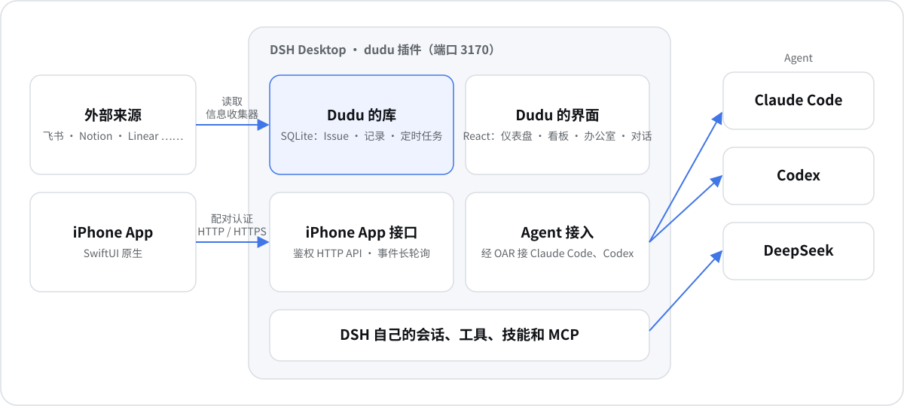

<div align="center">


### 基于 Issue 的多 Agent 高效协作助手

Dudu 是 DeepSeek 开源的 Agent 应用 [DeepSeek Harness](https://github.com/deepseek-ai/deepseek-harness)（DSH）的插件，另有配套的 iPhone App。它用 Issue 管理交给 Claude Code、Codex 和 DeepSeek 的工作。Dudu 处于早期阶段，界面和接口还会变化。

[](LICENSE)   

**[快速开始](#快速开始)** &nbsp;·&nbsp; **[功能](#功能)** &nbsp;·&nbsp; **[文档](#文档)** &nbsp;·&nbsp; **[App Store][app-store]**

<br>


</div>

<br>

## 为什么用 Dudu

同时使用几个 Agent 时，每个会话各自独立，进度和问题只能逐个打开查看。Dudu 把它们集中到一个看板上：

- **以 Issue 为中心**：一项工作对应一个 Issue，交给一个 Agent 处理。会话关闭或更换后，Issue 和它的记录仍然保留。
- **需要你处理的排在最前**：看板按 Agent 的状态分组，轮到你处理的 Issue 排在最前。
- **决定权在你**：Dudu 只保存收集到的信息，不会自己创建 Issue；Issue 的状态、交给哪个 Agent，都由你决定。

## 概念

- **Issue**：一项要交给 Agent 的工作。界面里叫「事项」。
- **Agent**：处理 Issue 的 Claude Code、Codex 或 DSH 自带的 DeepSeek。界面里叫「智能体」。
- **会话**：Agent 的会话，也就是 DSH 侧栏里的会话。
- **项目**：DSH 里的项目，也就是工作区文件夹。Issue 可以属于一个项目；交给 Agent 之前要先选项目，Agent 在项目的文件夹里工作。
- **嘟嘟**：Dudu 在界面里的中文名。DSH 侧栏里的「嘟嘟」打开 Dudu 的页面（仪表盘），页面右下角的「嘟嘟」打开和 Dudu 的对话。
- **对话**：你和 Dudu 本身的聊天，只有一个。

界面文字跟随 DSH 的语言设置，本文引用的是中文界面。信息收集器在界面里叫「信息」，定时任务叫「任务」。

## 快速开始

环境要求：

- macOS。
- DSH Desktop（在 0.2.2-rc.1 上测试过，见[兼容说明](docs/dsh-0.2.2-compatibility.md)），可从 [DSH 主页](https://deepseek.com/harness)下载。DSH 里要先配置好模型，Dudu 的对话和 DeepSeek Agent 使用它。
- Node.js 24 或更新版本和 Git（`npm install` 会构建 OAR 适配层）。
- 要用 Claude Code 或 Codex，需要它们已安装并登录。

**1. 安装插件**

```sh
git clone https://github.com/weiwenhao/dudu.git
cd dudu
npm install
npm run desktop:update       # 打包、装进 DSH Desktop 并让它重新加载
```

`desktop:update` 只支持 macOS，需要 DSH Desktop 装在 `/Applications` 里并且至少启动过一次。不用脚本时，运行 `npm run package:desktop`，再把生成的 `.local/release/dudu-<版本>.tgz` 在 DSH Desktop 的「插件」里安装。

装好后，在 DSH 左侧栏打开「嘟嘟」。

**2. 创建第一个 Issue**

在「嘟嘟」页面点「新建事项」，填写标题，选一个项目，再选 Agent，点创建。Agent 开始执行，状态显示在看板上。

**3. 安装并连接 iPhone App（可选）**

从 [App Store][app-store] 安装 iPhone App，需要 iOS 18 或更新版本。在「嘟嘟」页面点右上角的设置，进入「手机控制」，填写电脑名称，点「生成二维码」，用 iPhone App 扫描。用内网地址连接时，手机和电脑要在同一个内网里；第一个连接地址由电脑当前的内网 IP 自动生成。详见[手机连接](docs/phone-connection.md)。

## 功能

看板、信息收集器和办公室是仪表盘上的三个小组件，可以拖动，也可以调整大小。

### Issue 和看板

看板显示所有 Issue，可以按列表或看板查看。Issue 有状态、优先级、所属项目、标签、子 Issue 和截止日期，用法和 Linear 的 Issue 相近。状态默认有待规划、待办、处理中、待审核、已完成和已取消，由你手动修改，不随 Agent 的运行变化。右键可以修改状态、优先级、标签和截止日期，把 Issue 交给 Agent，或复制编号。

看板默认按 Agent 的状态分成四组：「需要你」（Agent 提出问题、出错、停止或完成一轮回答）、「工作中」、「空闲中」（Agent 没在做事，也没在等你）和「未分配」（还没有交给 Agent）。

Agent 在自己的会话里处理 Issue。Claude Code 和 Codex 的会话由它们自己保存，也可以在终端里用 `claude --resume`、`codex resume` 继续；DeepSeek 使用 DSH 自带的会话。

### 信息收集器

信息收集器放着读取到的内容，由你逐条处理：忽略、分享到某个 Issue（或直接发给它的 Agent），或新建 Issue。读取由「收集器」完成：先在设置里连接一个服务（内置目录有飞书、Google 日历和云端硬盘、Notion、Linear、Atlassian 等，也可以添加自定义连接器），再为它建一个收集器，设定读什么、多久读一次。每次读取会调用一次模型。

### 办公室

办公室里，每个已交给 Agent 的进行中 Issue 是一个小人，位置对应 Agent 的状态：工作中的在工位上；等你处理的和空闲的在休息区；进入深度睡眠（进程已关闭）的在床上。

### 对话

和 Dudu 的对话只有一个，一直延续，使用 DSH 里配置的模型。桌面端从右下角的「嘟嘟」打开，iPhone App 里在侧栏中。输入 `@` 选一个 Issue，再输入要说的话，这句话会发给这个 Issue 的 Agent，回复也出现在这个对话里。过长的回复会折叠，点「展开」查看全文。Dudu 有自己的记忆、规则和技能，在设置里管理。

### 定时任务

定时任务按计划运行一条提示词：每天、每周、每月、固定间隔、仅一次，或自定义 cron。由 Claude Code、Codex、DeepSeek 或 Dudu 自己执行；Dudu 自己执行的任务，结果显示在对话里。

### 额度

点右上角的额度图标，查看 Claude、ChatGPT（Codex）的订阅额度和 DeepSeek 的账户余额。只在点击时查询，读取不到的来源不显示。

### iPhone App

用 SwiftUI 开发；DSH 自己的配置页面在 App 里以网页形式打开。首页是看板，点一行打开这个 Issue 的会话；另有对话、信息收集器、定时任务和额度，支持语音输入，可以发送图片和文件。

## 整体结构

<p align="center"></p>

- Issue、收集到的信息和定时任务保存在本机的 SQLite 和文件中。
- Claude Code 和 Codex 通过 [OAR](https://www.npmjs.com/package/@botiverse/oar)（控制命令行 Agent 的库）接入 DSH；DeepSeek 使用 DSH 自带的会话。
- iPhone App 经带鉴权的 HTTP/HTTPS 直连电脑，实时更新使用 HTTP 长轮询。Dudu 没有自己的云端服务。

## 安全

- 配对码只在你点「生成二维码」时生成，10 分钟有效，每台手机可以单独撤销。安装插件和保存连接地址都不会自动生成配对码。
- iPhone App 只能访问 Dudu 插件自己提供的页面和接口，每次都要先配对：没有匿名页面，也不能借它访问任意网址或调用 DSH 的任意功能。配对凭据只放在 `Authorization` 请求头里，不出现在网页脚本和 URL 中。
- 内网地址使用 HTTP，传输不加密。通过 TLS 反向代理或隧道（HTTPS）连接时，中转服务器能看到解密后的流量，这不是端到端加密。
- Dudu 的对话和收集、Codex 和 DeepSeek 的 Agent 默认以完全访问权限运行，Claude Code 使用它自己的权限设置。DSH 里不会弹出 Agent 的审批提问：Claude Code 需要确认的操作会被拒绝，Codex 不询问。
- 数据保存在本机。发给模型的内容，发往你自己配置的模型提供方。

## 文档

| 内容 | 文档 |
| --- | --- |
| 整体设计：产品、架构、界面、接口 | [docs/assistant.md](docs/assistant.md) |
| 连接手机、安装 App、配对 | [docs/phone-connection.md](docs/phone-connection.md) |
| 在 DSH 里使用 Claude Code 和 Codex | [docs/providers.md](docs/providers.md) |
| 定时任务 | [docs/scheduled-tasks.md](docs/scheduled-tasks.md) |
| Issue 接口 | [docs/issues-api.md](docs/issues-api.md) |
| 为 Dudu 编写小组件 | [examples/dudu-widget](examples/dudu-widget) |

## 开发与贡献

```sh
npm run typecheck
npm test               # 单元测试，很快；只保留关键用例：数据安全、鉴权、进程间约定、状态和分配规则
npm run test:e2e       # 端到端：把插件装进一个独立的 dsh web，用 Chrome 驱动；较慢，需要 dsh 命令（或用 DUDU_E2E_DSH 指定）和 Chrome
npm run native:build   # 检查 iPhone App 能否编译
```

界面外观（尺寸、间距、文字、动画）不写自动化测试，由人工检查。

较大的改动请先在 GitHub 上提 Issue 讨论，Bug 和建议也提在那里。开发约定见 [AGENTS.md](AGENTS.md) 和 [native/AGENTS.md](native/AGENTS.md)，它们是写给编码 Agent 的，其中的签名和测试审批流程是作者自己的工作方式。

<details>
<summary>目录</summary>

| 位置 | 用途 |
| --- | --- |
| `host/dudu-plugin/` | DSH 插件入口，以及 Dudu 页面的 React 界面（`ui/`，shadcn/ui + Tailwind） |
| `host/assistant/` | Dudu 的核心库：Issue、收集器、连接器、分配、定时任务、仪表盘版面、对话 |
| `host/providers/` | 接入 Claude Code、Codex（基于 OAR）、读取额度、读取已有会话 |
| `host/native-*.mjs` | iPhone App 用的接口：鉴权 HTTP API、页面会话、事件长轮询 |
| `native/` | iPhone App（SwiftUI，工程由 `native/project.yml` 经 XcodeGen 生成） |
| `packages/oar-adapter/` | 对 OAR 的适配和补丁 |
| `examples/dudu-widget/` | 小组件模板 |
| `scripts/` | 打包、安装、构建脚本 |
| `docs/` | 设计和说明 |
| `tests/` | 单元测试；`tests/e2e/` 是真实 DSH 里的端到端测试 |
| `desktop/` | 发布包里的 README；其余是旧版（`dsbot` 时期）的连接脚本，仅作参考 |
| `App.tsx`、`src/`、`host/plugin/`、`plugins/`、`assets/`、`app.json`、`eas.json` | 旧的 Expo 原型，仅作参考，不在运行链路里 |

</details>

## 友链

<table>
<tr>
<td width="200" align="center"><a href="https://linux.do/"></a></td>
<td><b><a href="https://linux.do/">LINUX DO</a></b>：「新的理想型社区」，社区文化是真诚、友善、团结、专业。</td>
</tr>
<tr>
<td width="200" align="center"><a href="https://www.v2ex.com/"></a></td>
<td><b><a href="https://www.v2ex.com/">V2EX</a></b>：创意工作者的社区，讨论编程、设计、硬件、游戏等话题。</td>
</tr>
</table>

## 许可证

[MIT](LICENSE)

[app-store]: https://apps.apple.com/app/idXXXXXXXXXX
