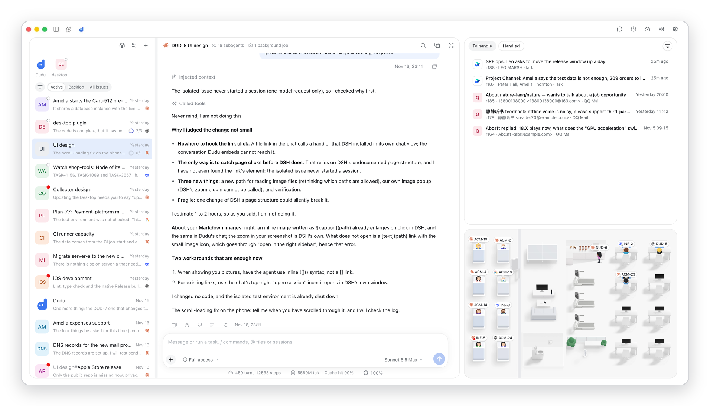

<div align="center">


### An efficient multi-agent collaboration assistant built on DSH

[](LICENSE)   

[Design philosophy](#design-philosophy) • [Features](#features) • [Development guide](#development-guide) • **English** · [简体中文](README.zh-CN.md)

</div>

Dudu is a multi-agent collaboration workspace built on [DeepSeek Harness](https://github.com/deepseek-ai/deepseek-harness). To install it, enter dsh-dudu in DSH's "Add plugin".

<div align="center">
    
</div>

Dudu can be managed from your phone too: on iOS, search for dudu in the App Store; on Android, install the apk from [GitHub Release](https://github.com/weiwenhao/dudu/releases).

<div align="center">
  
</div>

The workspace's home page is a dashboard: you can arrange its layout freely and develop widgets of your own.

<div align="center">
  
</div>

## Design philosophy

Built on [oar](https://github.com/botiverse/oar), Dudu brings many kinds of agents (TUIs) together in one GUI, which solves the problem of managing multiple agents. It manages task status efficiently with a board, and agent status efficiently with sessions.

The picture above is the workspace I use every day. I usually keep more than 30 agent sessions open, including Claude, Codex and DeepSeek, for personal projects as well as work projects. Dudu solves the problem of working efficiently in exactly this kind of multi-agent, multi-task setting. It has already replaced Herdr/Orca, which I had always used before.

Dudu is not a Grok Bot type of product. In a Bot type of product, a person only needs to chat with a few Bots to get a large number of tasks done, but I believe that in real work, talking directly to the agent doing the task is more accurate than having a Bot relay it.

Personal agents such as OpenClaw and Muse have long been very popular, and the DSH foundation makes it very easy to create one, so I also created the assistant **Dudu**. It is a personal agent similar to Muse, with a memory management system of its own. The assistant can operate every feature: the session board, writing widgets, connectors, collectors, scheduled tasks and so on. In the future it will take on more work to lighten my workload.

## Features

- Supports the DSH, Claude, Codex, Pi, Grok, Kimi, OpenCode, Antigravity, CodeBuddy, Devin, Factory, Qwen and Qoder agents, deeply integrated into the GUI.
- Easily import the DSH, Claude and Codex sessions you already have.
- Manage every feature by talking to Dudu, the personal assistant.
- Inactive agents go into deep sleep automatically, so they do not take up memory.
- Collaboration and session management are built around the Issue board.
- Sessions are managed like a chat app, so you can quickly find the ones whose work is done.
- Manage DSH sessions from your phone too: it is effectively the mobile client of DSH, on both iOS and Android.
- Collectors gather all your information in one place.
- With scheduled tasks you can send any agent to do anything, such as managing email or daily inspections.
- Check your Claude, Codex and DeepSeek quota at a glance.
- Every widget on the dashboard can be dragged and resized, and you can ask Dudu to write widgets of your own.
- There is also a cute office: when you are bored, see what your agents are up to.


## Data directories

| Directory | Contents |
| :-- | :-- |
| `~/.dsh` | DSH's data directory, i.e. `DSH_HOME` |
| `~/.dsh/dudu/home` | The assistant's home directory, also the working directory of its sessions: its Markdown files (`AGENTS.md`, `SOUL.md`, `USER.md`, `MEMORY.md` and so on) and the widgets it writes (`widgets/`). The location can be changed in Settings |
| `~/.dsh/dudu/assistant/` | The assistant's settings and databases (`settings.json`, `issues.db` and so on) |

## Development guide

Bug reports and suggestions are welcome in [GitHub Issues](https://github.com/weiwenhao/dudu/issues), and so are pull requests. For a larger change, please open an Issue first to talk about your idea.

### Development environment

You need Node.js 24 or later, Git and [DSH](https://deepseek.com/harness). Building the iOS app also needs Xcode and [XcodeGen](https://github.com/yonaskolb/XcodeGen); building the Android app also needs Android Studio.

```sh
git clone https://github.com/weiwenhao/dudu.git
cd dudu
npm install
```

### Run

```sh
npm run desktop:update     # package and install into the DSH Desktop on this computer; macOS only for now
npm run native:install     # build the iOS app and install it on an iPhone
npm run android:install    # build the Android app and install it on an emulator
```

Before building the iOS app, replace the developer team and the bundle ID in `native/project.yml` with your own.

Without `desktop:update`, run `npm run package:desktop`, then install `dsh-dudu-<version>.tgz` from `.local/release/` in DSH's "Add plugin".

### Test

```sh
npm run typecheck
npm test             # unit tests
npm run test:e2e     # end-to-end tests, slower
```

### Developing widgets

Just ask Dudu to write one. It writes an `.mjs` file under `widgets/` in its home directory, and a few seconds later the widget shows up under "Add widget" in "Edit layout": no plugin to install, no code to clone. See [WIDGETS.md](host/dudu-plugin/WIDGETS.md) for how to write one.

To publish a widget for others to use, make it a DSH plugin: see the [widget template](examples/dudu-widget/README.md).

## Recommended communities

<table>
<tr>
<td width="200" align="center"><a href="https://linux.do/"></a></td>
<td><b><a href="https://linux.do/">LINUX DO</a></b>: "Where possible begins." Its culture is sincerity, friendliness, unity and professionalism.</td>
</tr>
<tr>
<td width="200" align="center"><a href="https://www.v2ex.com/"></a></td>
<td><b><a href="https://www.v2ex.com/">V2EX</a></b>: a community of creative workers, talking about programming, design, hardware, games and more.</td>
</tr>
</table>
