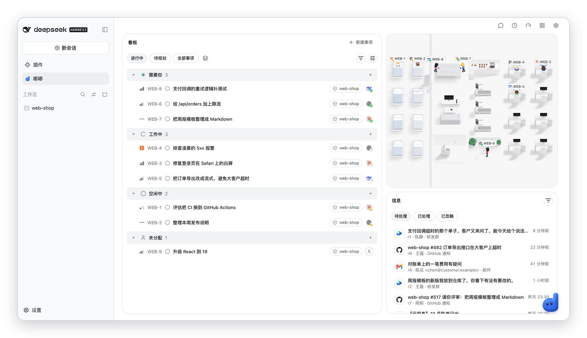
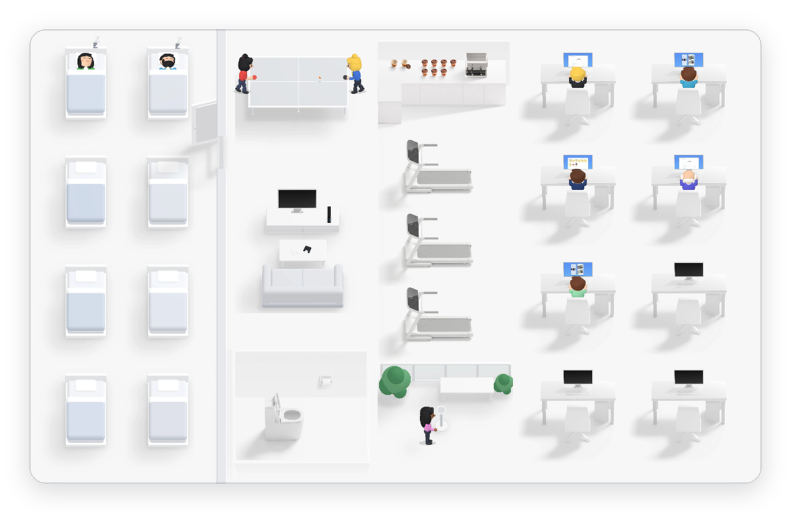

<div align="center">


# 嘟嘟 · Dudu

### 事交给智能体，需要你的时候才叫你。

**有人催你补材料，嘟嘟收进来；你点一下，交给 Claude Code、Codex 或 DeepSeek 去做；它卡住了，或者做完了，看板上就归到「需要你」。**<br>
电脑上是 DeepSeek Harness 的插件，手机上是原生 iPhone App，同一份事项，同一个对话。

[](LICENSE)   

**[快速开始](#快速开始)** &nbsp;·&nbsp; **[设计文档](docs/assistant.md)** &nbsp;·&nbsp; **[手机连接](docs/phone-connection.md)** &nbsp;·&nbsp; **[文档](#文档)** &nbsp;·&nbsp; **[LINUX DO](https://linux.do/)** &nbsp;·&nbsp; **[V2EX](https://www.v2ex.com/)**

<br>



</div>

<br>

## 嘟嘟适合你吗？

你同时在用 Claude Code、Codex、DeepSeek，事情还不断从聊天、邮件、工单里冒出来。会话散在各处：哪个在等你，哪个卡住了，哪个已经做完，只能一个个点开看。

嘟嘟把这些收成一张清单：

- **一件事一条事项**：收集来的信息，或者你随口一句话，建成事项（Issue）。每个事项一个长期会话，会话可以关掉、换掉、恢复，事项一直在。
- **谁在干活，一眼看清**：列表和看板按「工作中 / 需要你 / 空闲中」分组。智能体提了问题、出了错、做完了，都归到「需要你」。
- **交给合适的智能体**：Claude Code、ChatGPT（Codex）、DeepSeek。Claude 的额度用完了，把事项换给 ChatGPT，过程记录跟着事项走。
- **电脑和手机是同一份**：手机首页是看板，点一行进这个事项的会话；信息收集器、任务、额度也都在手机上。
- **你说了算**：嘟嘟只收集，不替你处理收来的信息，也不会自己建事项；事项的状态只由你改。

如果你同时用多个智能体、事情从多个地方来，它是为你做的。只用一个智能体、事情不多的话，用不上。

> 早期项目，界面和接口还会变。

## 能做什么

<table>
<tr><td width="110" nowrap><b>收集信息</b></td><td>连接器（一段 Prompt，或 DSH 里已经连上的 MCP 服务）加收集器（收什么、多久一次），把外面的信息读成一条条记录，放进信息收集器等你处理：忽略、分享到某个事项或会话、新建事项。</td></tr>
<tr><td width="110" nowrap><b>事项和看板</b></td><td>结构照 Linear：状态、优先级、项目、标签、子事项、截止日期。有列表，有看板，右键就能改状态、分配、复制编号。</td></tr>
<tr><td width="110" nowrap><b>智能体做事</b></td><td>会话是 Claude Code、Codex 真实的会话，在终端里 <code>claude --resume</code>、<code>codex resume</code> 也能接着聊；DeepSeek 用 DSH 自己的。</td></tr>
<tr><td width="110" nowrap><b>和嘟嘟说话</b></td><td>嘟嘟只有一个对话，电脑上收成右下角的宠物。像群聊一样用 <code>@事项编号</code> 把话带给那个事项的智能体，它的回复回到对话里；长回复折起来，点「展开」再看。</td></tr>
<tr><td width="110" nowrap><b>任务</b></td><td>按规则定时执行的任务：每天、每周、每月、隔一段时间、只跑一次，或者一条 cron。嘟嘟自己也可以当执行者，结果回到对话里。</td></tr>
<tr><td width="110" nowrap><b>额度</b></td><td>Claude、ChatGPT 的订阅额度和 DeepSeek 的余额还剩多少，点一下就看。</td></tr>
<tr><td width="110" nowrap><b>办公室</b></td><td>每个在做的事项是办公室里的一个人：干活的坐在工位上，等你的在休息区，很久没人管的躺在床上睡觉。</td></tr>
<tr><td width="110" nowrap><b>手机 App</b></td><td>SwiftUI 原生，不套网页壳。看板、对话、信息收集器、任务、额度，加上语音、图片和文件。</td></tr>
</table>

## 手机上

<p align="center"></p>

左边是嘟嘟的对话：`@WEB-12` 一句话问进度，Codex 的回复回到这里，长的折起来；下面三个按钮直达待办、信息和任务。右边是任务页。

## 办公室

<p align="center"></p>

仪表盘上的一个小组件。看板上的状态，在这里是看得见的：谁在干活，谁在等你，谁睡着了。

## 快速开始

需要：

- macOS，DSH Desktop 0.2.x（在 0.2.2-rc.1 上验证，见 [兼容说明](docs/dsh-0.2.2-compatibility.md)），Node.js 22.18 或更新。
- 要装手机 App：另需 Xcode 27.2 或更新、XcodeGen，和一个能给你的手机签名的 Apple 开发者账号。App 最低 iOS 18。目前没有 TestFlight 和 App Store 版本，要自己编译安装。

**1 · 装插件。**

```sh
npm install
npm run package:desktop      # 打出 .local/release/dudu-<版本>.tgz，在 DSH Desktop 的「插件」里安装
npm run desktop:update       # 或者：macOS 上一步到位，打包、装进 DSH Desktop 并热重载
```

**2 · 装手机 App，配对。**

```sh
npm run native:build         # 构建 iPhone App
npm run native:install       # 覆盖安装到已配对的手机
```

在 DSH 里打开嘟嘟，进右上角设置的「手机控制」，填好电脑的连接地址，手动点「生成二维码」，用手机上的 Dudu 扫。连接方式和细节见 [手机连接](docs/phone-connection.md)。

**3 · 派第一件事。** 在嘟嘟页面点「新建事项」，选好项目和智能体，写一句要做什么。它开始做，状态在看板上，手机上也看得到。

## 怎么搭起来

<p align="center"></p>

- **嘟嘟的库**：事项、记录、任务、仪表盘版面，都存在你电脑上的 SQLite 和文件里。
- **供应商**：经 [OAR](https://www.npmjs.com/package/@botiverse/oar) 把电脑上装好的 Claude Code 和 Codex 接进 DSH，会话是它们自己的真实会话。
- **手机接口**：带鉴权的 HTTP/HTTPS 接口和页面，实时更新靠长轮询，不用 WebSocket。
- **嘟嘟用 DSH 已有的东西**：工具、技能、智能体、MCP，自己不另造一套。

## 安全

- 配对码只能你手动生成，10 分钟有效；每台手机可以单独撤销。安装插件、保存地址都不会自动生成配对码。
- 页面和接口都要先配对。没有匿名页面，也不转发任意 URL 或任意 DSH 调用；配对凭据只放在 `Authorization` 请求头里，不会进网页脚本和 URL。
- 数据都在你自己的电脑上，项目本身没有云端服务。发给模型的内容，去你自己配置的模型提供方。
- 用 TLS 反向代理或隧道连接时，中转服务器能看到解密后的流量，这不是端到端加密。

## 文档

| 想做的事 | 看这里 |
| --- | --- |
| 了解整个设计：产品、架构、界面、接口 | [docs/assistant.md](docs/assistant.md) |
| 连手机、装 App、配对 | [docs/phone-connection.md](docs/phone-connection.md) |
| 在 DSH 里用 Claude Code 和 Codex | [docs/providers.md](docs/providers.md) |
| 任务（定时任务） | [docs/scheduled-tasks.md](docs/scheduled-tasks.md) |
| 调用事项的接口 | [docs/issues-api.md](docs/issues-api.md) |
| 给嘟嘟写一个小组件 | [examples/dudu-widget](examples/dudu-widget) |
| DSH 的兼容和会话控制 | [docs/dsh-0.2.2-compatibility.md](docs/dsh-0.2.2-compatibility.md) · [docs/dsh-session-control.md](docs/dsh-session-control.md) |
| 手机端遇到的问题和怎么修的 | [docs/native-mobile-fixes.md](docs/native-mobile-fixes.md) |

## 开发

```sh
npm run typecheck
npm test               # 单元测试，毫秒级；只留关键的：数据安全、鉴权、进程间约定、几条复杂规则
npm run test:e2e       # 端到端：把插件装进一个独立的 dsh web，用 Chrome 驱动；较慢，需要本机装有 DSH 和 Chrome
npm run native:build   # iPhone App 的检查
```

界面看起来对不对（尺寸、间距、字样、动画）不写测试，靠人看。

<details>
<summary>目录</summary>

| 位置 | 用途 |
| --- | --- |
| `host/dudu-plugin/` | DSH 插件入口，和嘟嘟页面的 React 界面（`ui/`，shadcn/ui + Tailwind） |
| `host/assistant/` | 嘟嘟的库：事项、收集器、连接器、分配、任务、仪表盘版面、对话 |
| `host/providers/` | 供应商（Claude Code、Codex，基于 OAR）、额度读取、读已有会话 |
| `host/native-*.mjs` | 手机接口：鉴权 HTTP API、页面会话、事件长轮询 |
| `native/` | iPhone App（SwiftUI，项目由 `native/project.yml` 经 XcodeGen 生成） |
| `packages/oar-adapter/` | 对 OAR 的适配和补丁 |
| `examples/dudu-widget/` | 给嘟嘟写小组件的模板 |
| `docs/` | 设计和说明 |
| `tests/` | 单元测试；`tests/e2e/` 是真实 DSH 里的端到端测试 |
| `App.tsx`、`src/`、`host/plugin/` | 旧的 Expo 原型，只留作参考，不在运行链路里 |

</details>

## 社区

想聊用法、提想法、分享你的玩法，来这里：

[**LINUX DO**](https://linux.do/) &nbsp;·&nbsp; [**V2EX**](https://www.v2ex.com/)

Bug 和建议也可以直接提 Issue。

## 贡献

动手之前请先读 [AGENTS.md](AGENTS.md) 和 [native/AGENTS.md](native/AGENTS.md)：界面要复用现有的组件和样式，不另起一套；界面上的字要作者看过；测试只留关键的；手机端的对话滚动有一串不能碰的约束。想改的东西比较大，建议先开 Issue 说一声。

## 许可证

[MIT](LICENSE)
