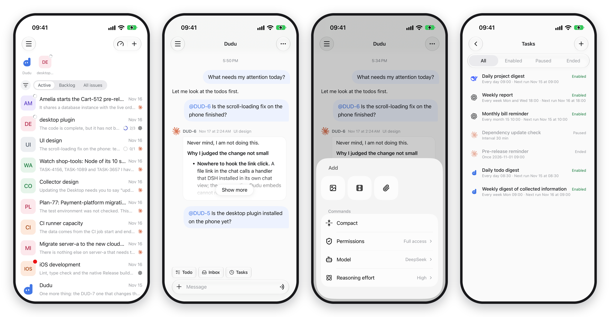
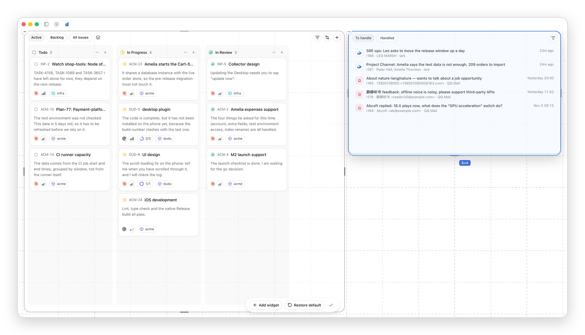

<div align="center">


### An efficient multi-agent collaboration assistant built on DSH

[](LICENSE)    

[Features](#features) • [Quick start](#quick-start) • [Docs](#docs) • [App Store][app-store] • **English** · [简体中文](README.zh-CN.md)


</div>

Dudu is a plugin for [DeepSeek Harness](https://github.com/deepseek-ai/deepseek-harness) (DSH), plus a mobile app. It is at 0.1.0 beta: the interface and APIs will still change.

> [!NOTE]
> **What is DSH?** An open-source agent app from DeepSeek whose motto is "Everything is a Plugin". Dudu is one of its plugins, so you need DSH Desktop first.

## Features

- **Issues**: every task is an Issue, with statuses, priorities and labels, as a list, a board like Linear's, or a list of conversations. Each conversation shows whether its Agent is working, has an unread reply, or is idle.
- **Agents**: Claude Code, Codex, Pi and DeepSeek. Claude Code and Codex run as the programs installed on your computer, with your login, settings, skills and MCP servers; Pi runs the installed `pi` (1.4.0 or later). Import the Claude Code and Codex sessions you already have, or take one over as an Issue.
- **Terminal**: copy a Claude Code or Codex session's resume command from its Issue and continue in a terminal. Use a session in one place at a time, DSH or the terminal.
- **Mobile app**: the same conversations in your pocket, with voice input.
- **Inbox**: a DSH model reads Lark, Notion, Linear and more through the collectors you set up, on a schedule you choose, so each collection costs tokens. Each record can become an Issue, go to an Agent as a message, or be ignored.
- **Chat**: ask Dudu to create an Issue, or type `@` to message an Issue's Agent. Open it from the blue icon at the bottom right.
- **Scheduled tasks**: run a prompt on a schedule.
- **Quota**: click the Quota icon at the top right to see what is left on Claude, ChatGPT and DeepSeek.
- **Office**: every active Issue is a little person: at a desk while its Agent works, in a bed when the session is asleep, in the lounge otherwise.
- **Dashboard**: drag and resize every widget.

**Mobile app.** From left to right: the conversation list, the chat, the chat's "+" menu, tasks.

<div align="center">
  
</div>

**Dashboard.** Drag and resize widgets from "Edit layout" at the top right. Here the Issues widget uses the board layout and the widget on the right is being resized.

<div align="center">
  
</div>

## Quick start

You need:

- macOS 13 or later on Apple silicon, with [DSH Desktop](https://deepseek.com/harness) (tested on 0.2.2-rc.1, see the [compatibility audit](docs/dsh-0.2.2-compatibility.md)) and a model set up in it
- Node.js 24 or later and Git
- Claude Code, Codex or Pi, installed and signed in, if you want to use them

### 1. Install the plugin

```sh
git clone https://github.com/weiwenhao/dudu.git
cd dudu
npm install
npm run desktop:update       # package, install into DSH Desktop and reload it
```

Then open "Dudu" in DSH's left sidebar. `desktop:update` needs DSH Desktop in `/Applications`, started once; its log is in `.local/desktop-updates/`. Without it, run `npm run package:desktop` and install `.local/release/dsh-dudu-<version>.tgz` from DSH Desktop's Plugins page.

### 2. Create an Issue

On the Dudu page click "New issue", enter a title, pick a project (a DSH workspace folder) and an Agent, and click "Create issue".

### 3. Follow it

The Agent starts working on the Issue. When it finishes its turn or asks a question, its conversation shows a red dot until you have read it: open it and answer, or set the Issue's status yourself. The status is always yours; an Agent never changes it.

### 4. Connect the mobile app (optional)

Install it from the [App Store][app-store] (iOS 18 or later; English and Chinese, following the phone's language). On the Dudu page click the settings icon at the top right, open "Phone control", enter a computer name, click "Generate QR code" and scan it with the app. A LAN address works only while the phone and the computer are on the same network. To use the app elsewhere, put your own HTTPS reverse proxy or tunnel in front of port 3170, then under "Connection addresses" click "Add address" and choose "Public address"; the app tries the LAN address first. DSH Desktop and the tunnel must keep running on the computer. More: [phone-connection.md](docs/phone-connection.md) (Chinese).

## Docs

| | |
| :-- | :-- |
| **[Design](docs/assistant.md)** | Product, structure, interface, APIs. Long, with the decision history (Chinese) |
| **[Mobile app](docs/phone-connection.md)** | Install and pair (Chinese) |
| **[Claude Code, Codex and Pi](docs/providers.md)** | How they run inside DSH (Chinese) |
| **[Scheduled tasks](docs/scheduled-tasks.md)** | (Chinese) |
| **[Issue API](docs/issues-api.md)** | (Chinese) |
| **[Widgets](examples/dudu-widget)** | Write a widget for Dudu |
| **[AGENTS.md](AGENTS.md)**, **[native/AGENTS.md](native/AGENTS.md)** | Conventions for coding agents. The signing and test-approval steps are the author's own workflow |
| **[GitHub Issues](https://github.com/weiwenhao/dudu/issues)** | Bugs and ideas |

## Development

```sh
npm run typecheck
npm test               # unit tests, fast
npm run test:e2e       # end to end, slower; needs the dsh command (or set DUDU_E2E_DSH) and Chrome
```

## Recommended sites

<table>
<tr>
<td width="200" align="center"><a href="https://linux.do/"></a></td>
<td><b><a href="https://linux.do/">LINUX DO</a></b>: "Where possible begins."</td>
</tr>
<tr>
<td width="200" align="center"><a href="https://www.v2ex.com/"></a></td>
<td><b><a href="https://www.v2ex.com/">V2EX</a></b>: a community of creative workers, talking about programming, design, hardware, games and more.</td>
</tr>
</table>

[app-store]: https://apps.apple.com/app/idXXXXXXXXXX
