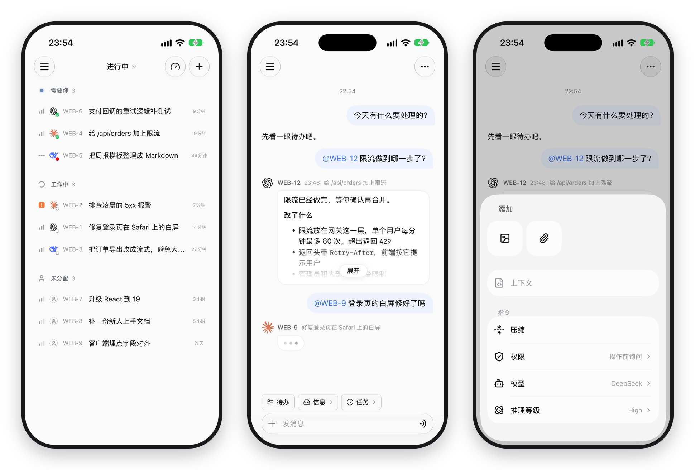

<div align="center">


# Dudu

### 基于 DSH 打造的多 Agent 协作的工作效率助手

你把活儿交给 Claude Code、Codex、DeepSeek，Dudu 帮你跟进：谁在做，谁做完了，谁在等你回答，看板上一眼看清，不用一个个点开会话去找。<br>
它始终是助手，不替你做重要决定：收进来的信息怎么处理，事项交给谁，做到哪一步算完，都由你来定。

电脑上是 DeepSeek Harness（DSH）的插件，手机上是 iPhone App，两边是同一份数据。

[](LICENSE)   

**[快速开始](#快速开始)** &nbsp;·&nbsp; **[设计文档](docs/assistant.md)** &nbsp;·&nbsp; **[手机连接](docs/phone-connection.md)** &nbsp;·&nbsp; **[文档](#文档)** &nbsp;·&nbsp; **[LINUX DO](https://linux.do/)** &nbsp;·&nbsp; **[V2EX](https://www.v2ex.com/)**

<br>


<sub>电脑上：DSH 里的 Dudu。左边是看板，右边是办公室，右下角的小宠物是和 Dudu 说话的地方。</sub>



<sub>手机上：看板；对话（用 @事项编号 把话带给它的 Agent，太长的回复会折起来）；对话里点「+」弹出的菜单。</sub>

</div>

<br>

## 什么时候用得上

你同时在用 Claude Code、Codex、DeepSeek，会话开了一堆：哪个在等你回答，哪个卡住了，哪个做完了，要一个个点开才知道。Dudu 把这些放到一块看板上。

它做这几件事：

- **一件事记成一条「事项」**（和 GitHub 的 Issue 差不多），交给一个 Agent 去做。会话关了、换了，事项和它的记录还在。
- **按状态分开放**：看板分成「工作中」「需要你」「空闲中」「未分配」。Agent 问了问题、出了错、做完了一轮，都算「需要你」。
- **电脑和手机是同一份**：手机首页就是看板，点一行进到这件事的对话。
- **决定权在你**：收进来的信息，Dudu 只存着，不会自己建事项；事项的状态也由你来改。

只用一个 Agent、事情也不多的话，用不上它。

> 早期项目，界面和接口还会变。

## 能做什么

<table>
<tr><td width="110" nowrap><b>收集信息</b></td><td>先告诉 Dudu 去哪里读：一段说明，或者 DSH 里已经连好的某个 MCP 服务；再告诉它读什么、隔多久读一次。读回来的内容放进「信息收集器」，一条一条等你处理：忽略、转给某件事，或者新建一件事。</td></tr>
<tr><td width="110" nowrap><b>事项和看板</b></td><td>和 Linear、GitHub 的 Issue 差不多：状态、优先级、所属项目、标签、子事项、截止日期。可以看列表，也可以看看板；右键能改状态、优先级、标签、截止日期，把事项交给 Agent，复制编号。</td></tr>
<tr><td width="110" nowrap><b>Agent 做事</b></td><td>做事的是你电脑上装好的 Claude Code、Codex，和 DSH 自带的 DeepSeek。它们的会话是真会话：在终端里用 <code>claude --resume</code>、<code>codex resume</code>，也能接着聊。</td></tr>
<tr><td width="110" nowrap><b>和 Dudu 说话</b></td><td>Dudu 只有一个对话，电脑上是右下角的小宠物（界面里叫「嘟嘟」）。写「<code>@事项编号</code> 加一句话」，这句话就发给那件事的 Agent，回复会回到同一个对话里。太长的回复会折起来，点「展开」看全文。</td></tr>
<tr><td width="110" nowrap><b>定时任务</b></td><td>到点自动去做的事：每天、每周、每月、隔一段时间、只做一次，或者写一条 cron。Dudu 自己也能当执行者，结果发到对话里。</td></tr>
<tr><td width="110" nowrap><b>额度</b></td><td>点右上角的额度图标，看 Claude 和 ChatGPT 的订阅还剩多少、DeepSeek 的账户余额还有多少。平时不查，点了才查；读不到的就不显示。</td></tr>
<tr><td width="110" nowrap><b>手机 App</b></td><td>用 SwiftUI 写的 iPhone App，不是网页套壳。有看板、对话、信息收集器、定时任务、额度，还能语音输入、发图片和文件。</td></tr>
</table>

## 办公室

<p align="center"></p>

仪表盘上的一个小组件，和看板对着看：在做事的坐在工位上，等你的和空闲的在休息区活动，长时间没人管、进程已经关掉的躺在床上睡觉。

## 快速开始

需要：

- macOS、DSH Desktop 0.2.x（我们在 0.2.2-rc.1 上试过，见 [兼容说明](docs/dsh-0.2.2-compatibility.md)）、Node.js 22.18 或更新。
- 要装手机 App，还需要 Xcode 27.2 或更新、XcodeGen，和一个能给你的手机签名的 Apple 开发者账号。App 最低支持 iOS 18。现在没有 TestFlight 和 App Store 版本，要自己编译。

**1 · 装插件。**

```sh
npm install
npm run package:desktop      # 打出 .local/release/dudu-<版本>.tgz，在 DSH Desktop 的「插件」里安装
npm run desktop:update       # 或者：在 macOS 上一步做完，打包、装进 DSH Desktop 并热重载
```

**2 · 装手机 App，配对。**

```sh
npm run native:build         # 构建 iPhone App
npm run native:install       # 覆盖安装到已配对的手机
```

在 DSH 左边栏打开「嘟嘟」（Dudu 的中文名），进右上角设置的「手机控制」，填好电脑的连接地址，手动点「生成二维码」，用手机上的 Dudu 扫。连接方式和细节见 [手机连接](docs/phone-connection.md)。

**3 · 派第一件事。** 在「嘟嘟」页面点「新建事项」，选好项目和 Agent，写一句要做什么。它就开始做，状态显示在看板上，手机上也看得到。

## 它是怎么搭起来的

<p align="center"></p>

- Dudu 跑在你电脑上的 DSH Desktop 里，是它的一个插件。事项、收集来的信息、任务这些数据，存在你电脑上的 SQLite 和文件里。
- 接 Claude Code 和 Codex 的那一部分，用 [OAR](https://www.npmjs.com/package/@botiverse/oar) 把它们接进 DSH；会话还是它们自己的真实会话。DeepSeek 用 DSH 自带的。
- 手机直接连你的电脑：走带鉴权的 HTTP/HTTPS，实时更新靠长轮询，不用 WebSocket。这个项目没有自己的云端服务。
- 工具、技能、MCP，用的都是 DSH 已有的，Dudu 不另做一套。

## 安全

- 配对码只能你手动生成，10 分钟有效，每台手机可以单独撤销。装插件、保存地址都不会自动生成配对码。
- 页面和接口都要先配对。没有匿名页面，不转发任意 URL，也不转发任意的 DSH 调用；配对凭据只放在 `Authorization` 请求头里，网页脚本和 URL 里都没有。
- 数据都在你自己的电脑上。发给模型的内容，去你自己配置的模型提供方。
- 如果你用 TLS 反向代理或隧道连接，中转服务器能看到解密后的流量，这不是端到端加密。

## 文档

| 想做的事 | 看这里 |
| --- | --- |
| 了解整个设计：产品、架构、界面、接口 | [docs/assistant.md](docs/assistant.md) |
| 连手机、装 App、配对 | [docs/phone-connection.md](docs/phone-connection.md) |
| 在 DSH 里用 Claude Code 和 Codex | [docs/providers.md](docs/providers.md) |
| 定时任务 | [docs/scheduled-tasks.md](docs/scheduled-tasks.md) |
| 调用事项的接口 | [docs/issues-api.md](docs/issues-api.md) |
| 给 Dudu 写一个小组件 | [examples/dudu-widget](examples/dudu-widget) |
| DSH 的兼容和会话控制 | [docs/dsh-0.2.2-compatibility.md](docs/dsh-0.2.2-compatibility.md) · [docs/dsh-session-control.md](docs/dsh-session-control.md) |
| 手机端遇到的问题和怎么修的 | [docs/native-mobile-fixes.md](docs/native-mobile-fixes.md) |

## 开发

```sh
npm run typecheck
npm test               # 单元测试，毫秒级；只留关键的：数据安全、鉴权、进程间约定、几条复杂规则
npm run test:e2e       # 端到端：把插件装进一个独立的 dsh web，用 Chrome 驱动；较慢，需要本机装有 DSH 和 Chrome
npm run native:build   # iPhone App 的检查
```

界面看起来对不对（尺寸、间距、字样、动画）不写测试，靠人看。

<details>
<summary>目录</summary>

| 位置 | 用途 |
| --- | --- |
| `host/dudu-plugin/` | DSH 插件入口，和 Dudu 页面的 React 界面（`ui/`，shadcn/ui + Tailwind） |
| `host/assistant/` | Dudu 的库：事项、收集器、连接器、分配、任务、仪表盘版面、对话 |
| `host/providers/` | 接 Claude Code、Codex（基于 OAR）、读额度、读已有会话 |
| `host/native-*.mjs` | 手机接口：鉴权 HTTP API、页面会话、事件长轮询 |
| `native/` | iPhone App（SwiftUI，项目由 `native/project.yml` 经 XcodeGen 生成） |
| `packages/oar-adapter/` | 对 OAR 的适配和补丁 |
| `examples/dudu-widget/` | 给 Dudu 写小组件的模板 |
| `docs/` | 设计和说明 |
| `tests/` | 单元测试；`tests/e2e/` 是真实 DSH 里的端到端测试 |
| `App.tsx`、`src/`、`host/plugin/` | 旧的 Expo 原型，只留作参考，不在运行链路里 |

</details>

## 社区

用法、想法、问题，可以到这两个社区聊：

[**LINUX DO**](https://linux.do/) &nbsp;·&nbsp; [**V2EX**](https://www.v2ex.com/)

Bug 和建议也可以直接提 Issue。

## 贡献

动手之前先读 [AGENTS.md](AGENTS.md) 和 [native/AGENTS.md](native/AGENTS.md)。里面写了几条硬规矩：界面要复用现有的组件和样式；界面上的字要作者看过；测试只留关键的；手机端对话的滚动代码有一串不能碰的约束。改动比较大的话，先开 Issue 说一声。

## 许可证

[MIT](LICENSE)
