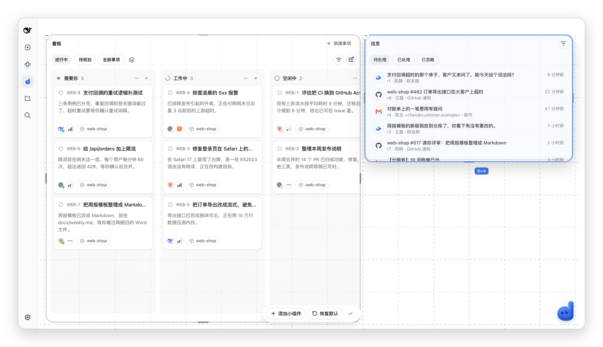

<div align="center">


### An efficient multi-agent collaboration assistant built on DSH

**Run many Claude Code, Codex and DeepSeek tasks at once and see which one is waiting for you.**<br>
Every task is an Issue on one board, on your desktop and on your phone.

[](LICENSE)    

If Dudu is useful to you, a star on GitHub helps others find it.

[How it works](#how-it-works) • [Features](#features) • [Quick start](#quick-start) • [Security](#security) • [Docs](#docs) • [App Store][app-store] • **English** · [简体中文](README.zh-CN.md)


</div>

Dudu is a plugin for [DeepSeek Harness](https://github.com/deepseek-ai/deepseek-harness) (DSH), plus a mobile app. It is at 0.1.0 beta: the interface and APIs will still change.

> [!NOTE]
> **What is DSH?** An open-source agent app from DeepSeek whose motto is "Everything is a Plugin". Dudu is one of its plugins, so you need DSH Desktop first.

## How it works

With several agents running, you open each session to find out who finished, who is stuck and who is asking you something. Dudu puts that on one board:

1. **One task, one Issue.** Issues are laid out like Linear's: statuses, priorities, labels, a list and a board. Hand one to an Agent (Claude Code, Codex or DeepSeek) and it works in its own DSH session, in your project folder.
2. **One board.** Issues are grouped by the Agent's state, and **Needs you** comes first: the Agent asked a question, failed, was stopped or finished its turn. Then Working, Idle and Unassigned.
3. **You decide.** Dudu never creates an Issue or changes a status on its own. You pick the Agent; when you ask Dudu in chat to create an Issue, it picks by the assignment rules you wrote.

## Features

- **Agents**: Claude Code, Codex and DeepSeek. Claude Code and Codex run as the programs installed on your computer, with your login, settings, skills and MCP servers. Import the sessions you already have, or take one over as an Issue.
- **Terminal**: copy a Claude Code or Codex session's resume command from its Issue and continue in a terminal. Do not write to one session from DSH and the terminal at the same time.
- **Mobile app**: the same board in your pocket, with voice input.
- **Collector**: a DSH model reads Lark, Notion, Linear and more on a schedule you set, so each collection costs tokens. Each item can become an Issue, go to an Agent as a message, or be ignored.
- **Chat**: ask Dudu to create an Issue, or type `@` to message an Issue's Agent. Open it from the blue icon at the bottom right.
- **Scheduled tasks**: run a prompt on a schedule.
- **Quota**: what is left on Claude, ChatGPT and DeepSeek. Nothing is read until you click the Quota icon at the top right.
- **Office**: every active Issue is a little person, at a desk when working, in the lounge when waiting, in bed when asleep.
- **Dashboard**: drag and resize every widget.

**Mobile app.** From left to right: the board, the chat, the chat's "+" menu, tasks.

<div align="center">
  
</div>

**Dashboard.** Drag and resize widgets from "Edit layout" at the top right. Here the Issues widget uses the board layout and the Collector is being resized (Chinese interface).

<div align="center">
  
</div>

## Quick start

You need:

- macOS 13 or later on Apple silicon, with [DSH Desktop](https://deepseek.com/harness) (tested on 0.2.2-rc.1, see the [compatibility audit](docs/dsh-0.2.2-compatibility.md)) and a model set up in it
- Node.js 24 or later and Git
- Claude Code or Codex, installed and signed in, if you want to use them

### 1. Install the plugin

```sh
git clone https://github.com/weiwenhao/dudu.git
cd dudu
npm install
npm run desktop:update       # package, install into DSH Desktop and reload it
```

Then open "Dudu" in DSH's left sidebar. `desktop:update` needs DSH Desktop in `/Applications`, started once; its log is in `.local/desktop-updates/`. Without it, run `npm run package:desktop` and install `.local/release/dudu-<version>.tgz` from DSH Desktop's Plugins page.

### 2. Create an Issue

On the Dudu page click "New issue", enter a title, pick a project (a DSH workspace folder) and an Agent, and click "Create issue".

### 3. Connect the mobile app (optional)

Install it from the [App Store][app-store] (iOS 18 or later; the interface is in Chinese for now). On the Dudu page click the settings icon at the top right, open "Phone control", enter a computer name, click "Generate QR code" and scan it with the app. A LAN address works only while the phone and the computer are on the same network. To use the app elsewhere, put your own HTTPS reverse proxy or tunnel in front of port 3170, then under "Connection addresses" click "Add address" and choose "Public address"; the app tries the LAN address first. DSH Desktop and the tunnel must keep running on the computer. More: [phone-connection.md](docs/phone-connection.md) (Chinese).

## Security

- **Pairing is manual.** A code appears only when you click "Generate QR code", lasts 10 minutes, and each phone can be revoked.
- **The app reaches only Dudu's own pages and APIs**, after pairing, with the credential in the `Authorization` header. A LAN address is plain HTTP; over a TLS proxy or tunnel the relay can read the traffic, so it is not end-to-end encrypted.
- **Agents run with full access** (any file, any command) for Dudu's chat, collection and scheduled tasks, and for Issues handed to Codex or DeepSeek. Claude Code Issues use Claude's own permission settings. DSH shows no approval prompts: what Claude Code would ask about is refused, and Codex never asks.
- **Your data stays on your computer** (`~/.dsh/dudu/`). What goes to a model goes to the provider you configured. Dudu has no cloud service.

## Docs

| | |
| :-- | :-- |
| **[Design](docs/assistant.md)** | Product, structure, interface, APIs. Long, with the decision history (Chinese) |
| **[Mobile app](docs/phone-connection.md)** | Install and pair (Chinese) |
| **[Claude Code and Codex](docs/providers.md)** | How they run inside DSH (Chinese) |
| **[Scheduled tasks](docs/scheduled-tasks.md)** | (Chinese) |
| **[Issue API](docs/issues-api.md)** | (Chinese) |
| **[Widgets](examples/dudu-widget)** | Write a widget for Dudu |
| **[AGENTS.md](AGENTS.md)**, **[native/AGENTS.md](native/AGENTS.md)** | Conventions for coding agents. The signing and test-approval steps are the author's own workflow |
| **[GitHub Issues](https://github.com/weiwenhao/dudu/issues)** | Bugs and ideas |

## Development

```sh
npm run typecheck
npm test               # unit tests, fast
npm run test:e2e       # end to end, slower; needs the dsh command (or set DUDU_E2E_DSH) and Chrome
```

## Friend links

<table>
<tr>
<td width="200" align="center"><a href="https://linux.do/"></a></td>
<td><b><a href="https://linux.do/">LINUX DO</a></b>: "Where possible begins."</td>
</tr>
<tr>
<td width="200" align="center"><a href="https://www.v2ex.com/"></a></td>
<td><b><a href="https://www.v2ex.com/">V2EX</a></b>: a community of creative workers, talking about programming, design, hardware, games and more.</td>
</tr>
</table>

[app-store]: https://apps.apple.com/app/idXXXXXXXXXX
