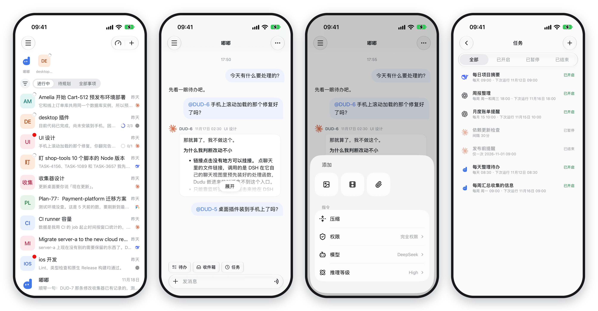
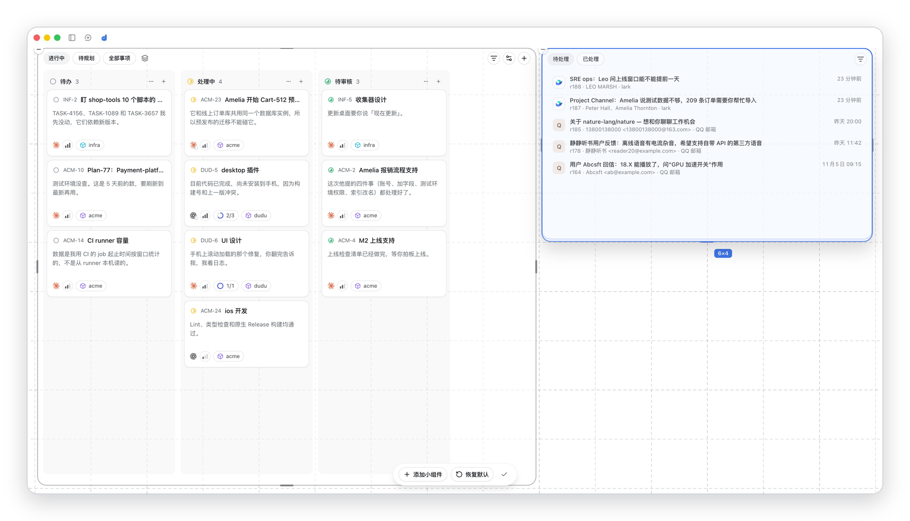

<div align="center">


### 基于 DSH 的多智能体高效协作助手

[](LICENSE)    

[设计理念](#设计理念) • [功能](#功能) • [贡献指南](#贡献指南) • [English](README.md) · **简体中文**

</div>

Dudu 是基于 [DeepSeek Harness](https://github.com/deepseek-ai/deepseek-harness) 开发的多智能体协作工作台，可以通过 DSH 插件搜索 dsh-dudu 快速安装。

<div align="center">
    
</div>

Dudu 支持手机端管理，iOS 在 App Store 搜索 dudu，安卓通过 [GitHub Release](https://github.com/weiwenhao/dudu/releases) 中的 apk 进行安装。

<div align="center">
  
</div>

工作台主页面采用了仪表盘的形式，可以自由组合布局，并且可以开发自己的小组件。

<div align="center">
  
</div>

## 设计理念

上面第一张图片就是我实际的工作台(做了隐私处理)，我常驻打开的智能体会话有 30 多个，包括 Claude/Codex/DeepSeek 等个人与工作项目，Dudu 解决的就是在这种多 Agent 多任务场景下的工作效率问题。

Dudu 将多个 TUI 所有会话聚合在一个 GUI 界面中解决多 Agent 的管理问题。基于看板管理任务状态，基于会话管理 Agent 状态，从而非常高效地管理多个任务与多个 Agent。Dudu 直接替代了我过去一直使用的 Herdr/Orca。

> 另一种会话管理方案是 Bot，人类只需要和少量的 Bot 聊天就能完成大量的任务，但我日常还没有使用这种工作流，我觉得在手机上这会很方便，但是当我使用电脑时，能够在对应的 Issue 直接对话相比于通过 Bot 转发会更加的准确高效。

基于 DSH 可以非常方便地打造个人智能体，所以我也将类似 Muse 一样的个人助理**嘟嘟**集成了进来。嘟嘟可以操作 Issue，连接器，收集器，定时任务等等所有插件功能，日常创建 Issue 或者定时任务我都是直接让嘟嘟帮我创建，而不需要我手动去填表单写提示词。

## 功能

- 支持 DSH、Claude、Codex、Pi，并深度集成到了 GUI 中。
- 方便地导入 DSH/Claude/Codex 会话。
- 通过个人助理嘟嘟管理所有插件功能。
- 不活跃的智能体会进入深度休眠，避免内存占用。
- 基于 Issue 看板进行协作与会话管理。
- 类似聊天软件一样的会话管理方式，可以快速定位到工作完成的会话。
- 通过手机管理 DSH 会话，本质上也是 DSH 的手机端，支持 iOS 和安卓。
- 使用收集器将你所有的信息都收集起来管理。
- 通过定时任务你可以派任何 Agent 做任何事情，比如邮件管理，日常巡检等。
- 可以快速查看 Claude/Codex/DeepSeek 额度。
- 仪表盘的每个小组件都可以拖动、调整大小，并且可以开发自己的小组件添加进来。
- 包含一个可爱的办公室，可以在无聊的时候看看你的 Agent 在干什么。


## 贡献指南

欢迎在 [GitHub Issues](https://github.com/weiwenhao/dudu/issues) 反馈 Bug 和建议，也欢迎提交 Pull Request。改动较大时，建议先开一个 Issue 说说你的想法。

### 准备环境

- macOS 13 或更新（Apple 芯片），已安装并启动过一次的 [DSH Desktop](https://deepseek.com/harness)（装在 `/Applications` 里），并在里面配好模型
- Node.js 24 或更新版本和 Git
- 要测试 Claude Code、Codex 或 Pi，需要它们已安装并登录
- 构建 iOS App 需要 Xcode（带 iOS 27 SDK 或更新）和 [XcodeGen](https://github.com/yonaskolb/XcodeGen)
- 构建安卓 App 需要 Android Studio（自带 JDK 21）和 Android SDK

```sh
git clone https://github.com/weiwenhao/dudu.git
cd dudu
npm install
```

### 项目结构

| 目录 | 内容 |
| :-- | :-- |
| `host/dudu-plugin/` | DSH 插件本体：入口 `index.mjs`，面板界面（React）在 `ui/`，小组件接口是 `widget*.mjs` |
| `host/assistant/` | Issue、收件箱、收集器、定时任务、仪表盘布局和嘟嘟 |
| `host/providers/` | Claude Code、Codex、Pi 的接入（通过 OAR）和额度读取；`native/` 读取它们自己的会话记录 |
| `host/native-*.mjs` | 手机 App 使用的接口（`/dsbot/api/v1/`） |
| `packages/oar-adapter/` | OAR 的兼容补丁 |
| `native/`、`native-android/` | iOS App（SwiftUI）、安卓 App（Kotlin、Jetpack Compose） |
| `examples/dudu-widget/` | 小组件模板 |
| `tests/` | 单元测试；`tests/e2e/` 是端到端测试 |
| `docs/` | 设计和说明文档 |

根目录的 Expo / React Native 文件（`App.tsx`、`src/` 等）是早期的原型，现在的手机 App 在 `native/` 里。

### 在 DSH Desktop 里运行

```sh
npm run desktop:update
```

它会打包插件、装进 DSH Desktop、请求热重载，并检查运行中的版本和服务是否就绪。热重载失败时 Desktop 保持打开并报告原因；确实要重启时加 `-- --restart`（会走 DSH 自己的退出确认）。DSH Desktop 不在 `/Applications` 里时用 `-- --app <路径>`。日志和配置备份在 `.local/desktop-updates/`。

请在普通终端里运行：热重载会断开 DSH 里正在运行的 Claude Code、Codex 会话，所以在 DSH 的会话里运行会被拒绝，确实要运行时加 `-- --force`。

不用脚本时，运行 `npm run package:desktop`，再在 DSH Desktop 的「插件」里安装 `.local/release/dsh-dudu-<版本>.tgz`。面板界面（`host/dudu-plugin/ui/`）由这两个命令一并编译；单独编译用 `npm run client:build`。

### iOS App

```sh
npm run native:build       # 构建
npm run native:install     # 构建并安装到已配对的 iPhone
```

`native:install` 需要一台已配对、可连接的真机；连了不止一台时用 `-- --device <标识>` 指定。`native/project.yml` 里的 `DEVELOPMENT_TEAM` 和 `PRODUCT_BUNDLE_IDENTIFIER` 是作者自己的，构建前换成你的（提交 PR 时不要带上这两处改动）。`npm run native:test` 在真机上运行 `native/DSBotTests` 里的单元测试。

### 安卓 App

```sh
npm run android:build      # 构建 debug APK，并运行单元测试和 lint
npm run android:install    # 装进正在运行的模拟器
```

`android:install` 只会选择正在运行的模拟器，不会选择真机；同时开着多个时用 `ANDROID_SERIAL=emulator-5554` 指定。默认使用 Android Studio 自带的 JDK 和 `~/Library/Android/sdk`，可用 `JAVA_HOME`、`ANDROID_HOME` 覆盖。APK 在 `native-android/app/build/outputs/apk/debug/app-debug.apk`。`npm run android:test` 只跑单元测试，`npm run android:e2e` 在模拟器里对隔离的测试环境跑关键界面流程。

### 测试

```sh
npm run typecheck
npm test                   # 单元测试，很快
npm run test:e2e           # 端到端，较慢
```

提交前至少运行 `npm run typecheck` 和与改动相关的单元测试。

- 单个单元测试文件可以用 `node --experimental-strip-types --test tests/文件名.test.ts` 运行。
- 端到端测试会先打包插件，再让每个测试文件在自己的 `DSH_HOME` 里启动一个真实的 `dsh web`，用已安装的 Chrome 操作界面。只有模型是假的，不会碰你自己的 DSH。它需要 `dsh` 命令（或用 `DUDU_E2E_DSH` 指向另一个 DSH，比如 Desktop 自带的 CLI）和 Chrome；只跑指定文件：`npm run test:e2e -- tests/e2e/issues.e2e.test.ts`。
- 新增测试要精简，只为「坏了、又没有更便宜的办法发现」的东西写，比如数据安全、安全和隐私、进程之间的约定、复杂的纯逻辑、每个主要功能的一条端到端流程，以及真的造成过麻烦的回归。不写外观和交互细节（尺寸、间距、颜色、文案）的测试，也不写要等真实计时器的测试。

## 社区推荐

<table>
<tr>
<td width="200" align="center"><a href="https://linux.do/"></a></td>
<td><b><a href="https://linux.do/">LINUX DO</a></b>：「新的理想型社区」，社区文化是真诚、友善、团结、专业。</td>
</tr>
<tr>
<td width="200" align="center"><a href="https://www.v2ex.com/"></a></td>
<td><b><a href="https://www.v2ex.com/">V2EX</a></b>：创意工作者的社区，讨论编程、设计、硬件、游戏等话题。</td>
</tr>
</table>
