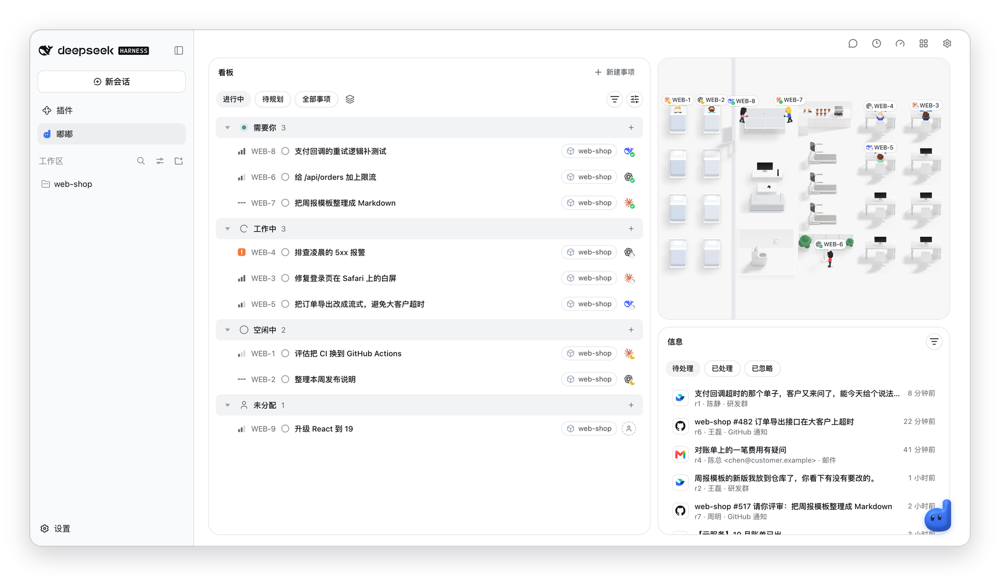

<div align="center">


### 基于 DSH 的多智能体高效协作助手

[](LICENSE)    

[设计理念](#设计理念) • [功能](#功能) • [贡献指南](#贡献指南) • [English](README.md) · **简体中文**

</div>

Dudu 是基于 [DeepSeek Harness](https://github.com/deepseek-ai/deepseek-harness) 开发的多智能体协作工作台，可以在 DSH 的「添加插件」中输入 dsh-dudu 快速安装。

<div align="center">
    
</div>

Dudu 支持手机端管理，iOS 在 App Store 搜索 dudu，安卓通过 [GitHub Release](https://github.com/weiwenhao/dudu/releases) 中的 apk 进行安装。

<div align="center">
  
</div>

工作台主页面采用了仪表盘的形式，可以自由组合布局，并且可以开发自己的小组件。

<div align="center">
  
</div>

## 设计理念

第一张图片就是我实际的工作台（做了隐私处理）。我常驻打开的智能体会话有 30 多个，包括 Claude、Codex、DeepSeek 等，既有个人项目，也有工作项目。Dudu 解决的就是这种多 Agent、多任务场景下的工作效率问题。Dudu 直接替代了我过去一直使用的 Herdr/Orca。

Dudu 将多个 TUI 里的所有会话聚合在一个 GUI 界面中，解决多 Agent 的管理问题。它基于看板管理任务状态，基于会话管理 Agent 状态，因此能非常高效地管理多个任务和多个 Agent。

还有一种流行的会话管理方式是 Bot，人类只需要和少量的 Bot 聊天就能完成大量的任务，但实际工作中直接和 Agent 对话比通过 Bot 转发更准确。当然，人类需要参与得更多，效率上会差一些。

此外，基于 DSH 底座打造个人智能体非常便捷，所以**嘟嘟**它来了，这是一个和 Muse 类似的个人智能体，有着自己的记忆管理系统。嘟嘟可以操作会话看板、编写小组件、连接器、收集器、定时任务等所有功能。

## 功能

- 支持 DSH、Claude、Codex、Pi 四种 Agent，并深度集成到了 GUI 中。
- 可以方便地导入已有的 DSH、Claude、Codex 会话。
- 通过个人助理嘟嘟，用对话的方式管理所有功能。
- 不活跃的智能体会自动进入深度休眠，避免占用内存。
- 以 Issue 看板为核心，进行协作和会话管理。
- 会话像聊天软件一样管理，可以快速定位到已经完成工作的会话。
- 在手机上也能管理 DSH 会话，相当于 DSH 的手机端，同时支持 iOS 和安卓。
- 用收集器把你所有的信息收集起来，统一管理。
- 通过定时任务，可以派任意 Agent 去做任何事情，比如邮件管理、日常巡检。
- 可以快速查看 Claude、Codex、DeepSeek 的额度。
- 仪表盘上的每个小组件都可以拖动、调整大小，你也可以开发自己的小组件添加进来。
- 还有一个可爱的办公室，无聊的时候可以看看你的 Agent 都在干什么。


## 贡献指南

欢迎在 [GitHub Issues](https://github.com/weiwenhao/dudu/issues) 反馈 Bug 和建议，也欢迎提交 Pull Request。改动较大时，建议先开一个 Issue 说说你的想法。

### 准备环境

- macOS 13 或更新（Apple 芯片），已安装并启动过一次的 [DSH Desktop](https://deepseek.com/harness)（装在 `/Applications` 里），并在里面配好模型
- Node.js 24 或更新版本和 Git
- 要测试 Claude Code、Codex 或 Pi，需要它们已安装并登录
- 构建 iOS App 需要 Xcode（带 iOS 27 SDK 或更新）和 [XcodeGen](https://github.com/yonaskolb/XcodeGen)
- 构建安卓 App 需要 Android Studio（自带 JDK 21）和 Android SDK

```sh
git clone https://github.com/weiwenhao/dudu.git
cd dudu
npm install
```

### 项目结构

| 目录 | 内容 |
| :-- | :-- |
| `host/dudu-plugin/` | DSH 插件本体：入口 `index.mjs`，面板界面（React）在 `ui/`，小组件接口是 `widget*.mjs` |
| `host/assistant/` | Issue、收件箱、收集器、定时任务、仪表盘布局和嘟嘟 |
| `host/providers/` | Claude Code、Codex、Pi 的接入（通过 OAR）和额度读取；`native/` 读取它们自己的会话记录 |
| `host/native-*.mjs` | 手机 App 使用的接口（`/dsbot/api/v1/`） |
| `packages/oar-adapter/` | OAR 的兼容补丁 |
| `native/`、`native-android/` | iOS App（SwiftUI）、安卓 App（Kotlin、Jetpack Compose） |
| `examples/dudu-widget/` | 小组件模板 |
| `tests/` | 单元测试；`tests/e2e/` 是端到端测试 |
| `docs/` | 设计和说明文档 |

根目录的 Expo / React Native 文件（`App.tsx`、`src/` 等）是早期的原型，现在的手机 App 在 `native/` 里。

### 目录

| 目录 | 内容 |
| :-- | :-- |
| `~/.dsh` | DSH 的数据目录，即 `DSH_HOME` |
| `~/.dsh/dudu/home` | 嘟嘟的家目录，也是嘟嘟会话的工作目录，放嘟嘟自己的 Markdown 文件（`AGENTS.md`、`SOUL.md`、`USER.md`、`MEMORY.md` 等），可以在设置里改位置 |
| `~/.dsh/dudu/assistant/` | 嘟嘟的设置和数据库（`settings.json`、`issues.db` 等） |
| `.local/` | 仓库里被 git 忽略的工作目录，打包出的插件在 `.local/release/`，更新日志和 profile 备份在 `.local/desktop-updates/` |

### 在 DSH Desktop 里运行

```sh
npm run desktop:update
```

它会打包插件、装进 DSH Desktop、请求热重载，并检查运行中的版本和服务是否就绪。热重载失败时 Desktop 保持打开并报告原因；确实要重启时加 `-- --restart`（会走 DSH 自己的退出确认）。DSH Desktop 不在 `/Applications` 里时用 `-- --app <路径>`。日志和配置备份在 `.local/desktop-updates/`。

请在普通终端里运行：热重载会断开 DSH 里正在运行的 Claude Code、Codex 会话，所以在 DSH 的会话里运行会被拒绝，确实要运行时加 `-- --force`。

不用脚本时，运行 `npm run package:desktop`，再在 DSH Desktop 的「插件」里安装 `.local/release/dsh-dudu-<版本>.tgz`。面板界面（`host/dudu-plugin/ui/`）由这两个命令一并编译；单独编译用 `npm run client:build`。

### iOS App

```sh
npm run native:build       # 构建
npm run native:install     # 构建并安装到已配对的 iPhone
```

`native:install` 需要一台已配对、可连接的真机；连了不止一台时用 `-- --device <标识>` 指定。`native/project.yml` 里的 `DEVELOPMENT_TEAM` 和 `PRODUCT_BUNDLE_IDENTIFIER` 是作者自己的，构建前换成你的（提交 PR 时不要带上这两处改动）。`npm run native:test` 在真机上运行 `native/DSBotTests` 里的单元测试。

### 安卓 App

```sh
npm run android:build      # 构建 debug APK，并运行单元测试和 lint
npm run android:install    # 装进正在运行的模拟器
```

### 测试

```sh
npm run typecheck
npm test                   # 单元测试，很快
npm run test:e2e           # 端到端，较慢
```

### 开发小组件

```sh
cp -r examples/dudu-widget /你的路径/my-widget
cd /你的路径/my-widget
npm install /绝对路径/dsh-dudu-<版本>.tgz    # npm run package:desktop 打出的包
npm run dev                                 # 构建
npm test                                    # 在 Chrome 里检查布局
```

详细步骤见[小组件模板](examples/dudu-widget/README.md)（英文），接口和设计见[设计文档](docs/assistant.md)的 3.8 和 4.1 节。装好后，在仪表盘的「编辑版面」里点「添加小组件」。

## 社区推荐

<table>
<tr>
<td width="200" align="center"><a href="https://linux.do/"></a></td>
<td><b><a href="https://linux.do/">LINUX DO</a></b>：「新的理想型社区」，社区文化是真诚、友善、团结、专业。</td>
</tr>
<tr>
<td width="200" align="center"><a href="https://www.v2ex.com/"></a></td>
<td><b><a href="https://www.v2ex.com/">V2EX</a></b>：创意工作者的社区，讨论编程、设计、硬件、游戏等话题。</td>
</tr>
</table>
